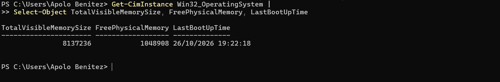
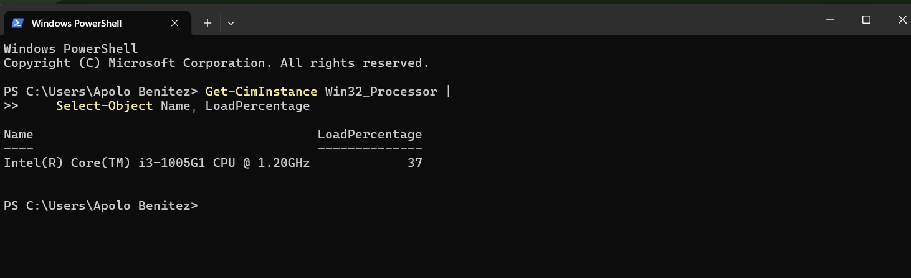
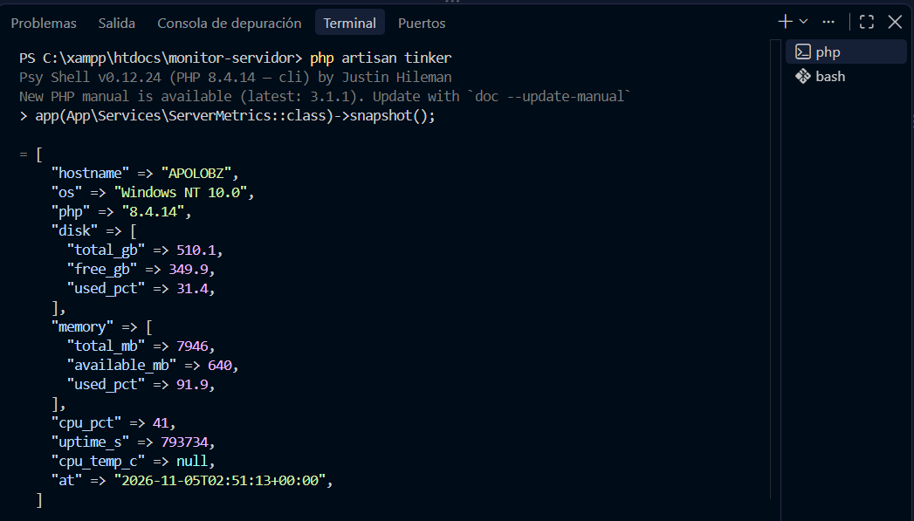
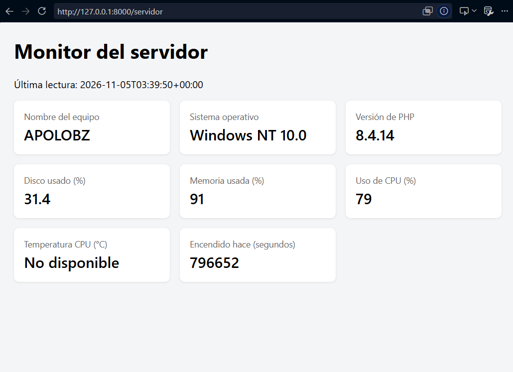
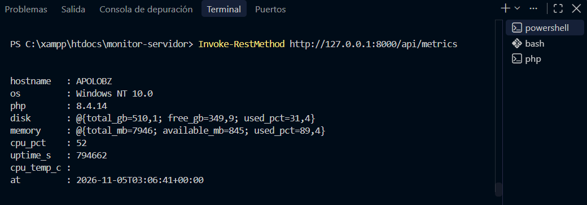
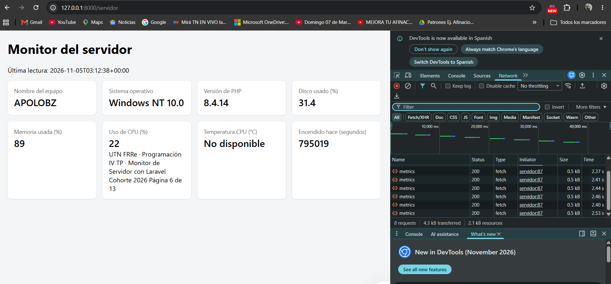
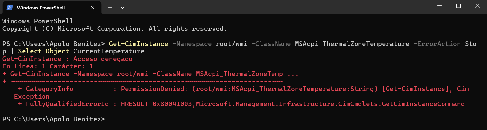
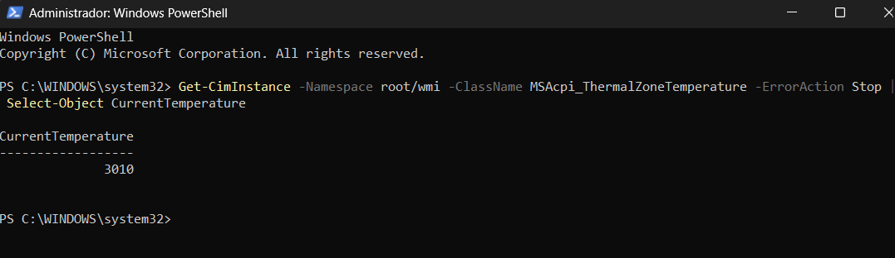
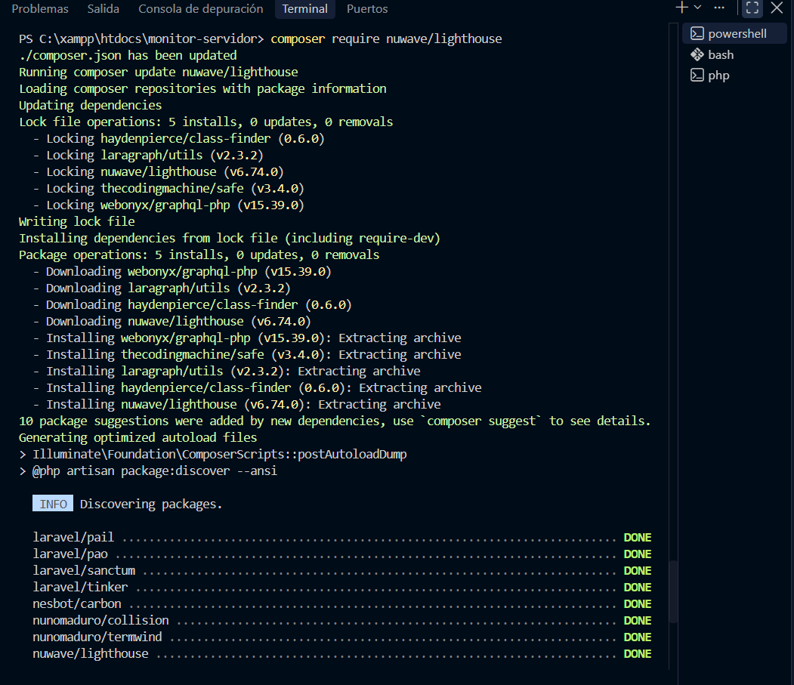
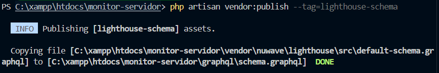

# Monitor de Servidor con Laravel

**Universidad Tecnológica Nacional – Facultad Regional Resistencia**  
**Materia:** Programación IV  
**Trabajo Práctico:** Monitor de Servidor con Laravel  
**Cohorte:** 2026

## 1. Descripción del proyecto

Este proyecto consiste en una aplicación web desarrollada con Laravel que permite consultar y visualizar información del sistema operativo donde se ejecuta el servidor.

Para obtener los datos se utilizan funciones de PHP y comandos de PowerShell, que consultan información de Windows mediante WMI (Windows Management Instrumentation).

La información se presenta en una vista web y mediante una API REST que devuelve los datos en formato JSON.

Además, se implementó un sistema de actualización automática mediante *polling*, que consulta las métricas cada 5 segundos sin necesidad de recargar la página.

## 2. Tecnologías utilizadas

- Laravel 13
- PHP 8.4.14
- PowerShell
- WMI (Windows Management Instrumentation)
- API REST
- JSON
- JavaScript
- Blade
- Composer

**Sistema operativo utilizado:** Windows (identificado por PHP como Windows NT 10.0).

**Equipo utilizado:** APOLOBZ.

**Procesador:** Intel Core i3-1005G1.

## 3. Funcionalidades

La aplicación permite visualizar:

- Nombre del equipo.
- Sistema operativo.
- Versión de PHP.
- Porcentaje de disco utilizado.
- Porcentaje de memoria RAM utilizada.
- Porcentaje de uso del procesador.
- Temperatura del procesador, cuando está disponible.
- Tiempo de funcionamiento del equipo.
- Fecha y hora de la última lectura.

Los datos se obtienen mediante el servicio `ServerMetrics`, ubicado en `app/Services/ServerMetrics.php`.

Este servicio centraliza la lectura de las métricas para reutilizarlas desde el controlador, la vista web y la API REST.

## 4. Instalación y ejecución

### Requisitos

- Windows 10 u 11.
- PHP 8.3 o superior.
- Composer.
- PowerShell.

### Instalación

**1. Clonar el repositorio:**

```bash
git clone URL_DEL_REPOSITORIO
cd monitor-servidor
```

**2. Instalar las dependencias:**

```bash
composer install
```

**3. Crear el archivo de configuración `.env`:**

Desde PowerShell:

```powershell
Copy-Item .env.example .env
```

**4. Generar la clave de Laravel:**

```bash
php artisan key:generate
```

**5. Configurar las siguientes variables en `.env`:**

```dotenv
SESSION_DRIVER=file
CACHE_STORE=file
QUEUE_CONNECTION=sync
```

Esta configuración permite ejecutar el monitor sin depender de una base de datos para las sesiones, la caché y las colas.

**6. Limpiar la configuración:**

```bash
php artisan config:clear
```

**7. Iniciar el servidor:**

```bash
php artisan serve
```

### Direcciones disponibles

**Monitor web:**

http://127.0.0.1:8000/servidor

**API REST:**

http://127.0.0.1:8000/api/metrics

También se puede consultar la API desde PowerShell:

```powershell
Invoke-RestMethod http://127.0.0.1:8000/api/metrics
```

## 5. Actualización automática (Polling)

La vista utiliza JavaScript para consultar la API cada 5 segundos.

La actualización se implementó mediante `fetch()` y `setInterval()`, permitiendo mostrar nuevas métricas sin recargar toda la página.

Para verificar su funcionamiento se utilizaron las herramientas de desarrollador del navegador, específicamente la pestaña Network.

Durante las pruebas se observaron solicitudes periódicas a `/api/metrics` que respondieron correctamente con estado HTTP 200.

## 6. Preguntas del trabajo práctico

### 1. ¿Por qué la temperatura suele aparecer como "No disponible" en Windows? Prueben abrir la terminal como administrador y comparen.

La temperatura puede aparecer como "No disponible" porque Windows restringe el acceso a determinada información del hardware o porque algunos sensores no proporcionan esos datos mediante WMI.

Para comprobarlo realicé la misma consulta desde PowerShell con dos niveles de permisos.

**Sin permisos de administrador:**

La consulta devolvió el error "Acceso denegado" (HRESULT 0x80041003).

**Con permisos de administrador:**

La consulta funcionó y devolvió el valor `CurrentTemperature = 3010`.

Aplicando la conversión utilizada en el proyecto:

`3010 / 10 - 273,15 = 27,85 °C`

Este valor corresponde a una lectura de la zona térmica informada por WMI, por lo que no necesariamente representa la temperatura real de los núcleos del procesador.

La comparación permitió comprobar que, en mi equipo, los permisos influyen en el acceso a la información térmica.

Esto explica por qué, al ejecutar normalmente el monitor Laravel sin permisos elevados, la temperatura aparece como "No disponible".

### 2. ¿Por qué el script de PowerShell nunca debe incluir datos que vengan del usuario?

Porque incorporar directamente datos ingresados por el usuario en los comandos de PowerShell puede generar vulnerabilidades de seguridad, como la inyección de comandos.

Esto podría permitir que una persona ejecute instrucciones no autorizadas en el sistema operativo, acceda a información o modifique archivos.

En este proyecto se utiliza un script fijo dentro de `ServerMetrics`, evitando construir comandos con información proporcionada por los usuarios.

### 3. ¿Qué riesgo tiene dejar `/api/metrics` sin autenticación en un servidor real?

El principal riesgo es que cualquier persona podría consultar información interna del servidor sin necesidad de identificarse.

La API expone datos como el nombre del equipo, sistema operativo, versión de PHP y consumo de recursos.

Aunque no sean contraseñas, esta información puede ayudar a identificar características de la infraestructura y facilitar posibles ataques.

En un entorno de producción sería necesario implementar autenticación y controlar qué usuarios pueden consultar las métricas.

Laravel Sanctum es una de las herramientas que se pueden utilizar para proteger el acceso a la API.

### 4. Con polling cada 5 segundos, ¿cuántos pedidos por minuto recibe el servidor si hay 50 personas mirando?

Cada usuario realiza una petición cada 5 segundos.

Primero calculamos la cantidad de peticiones por minuto de un usuario:

`60 / 5 = 12 peticiones por minuto`

Después multiplicamos por los 50 usuarios:

`50 × 12 = 600 peticiones por minuto`

**Respuesta: el servidor recibe 600 peticiones por minuto.**

Esto demuestra una desventaja del polling: genera solicitudes periódicas al servidor, incluso cuando la información no ha cambiado.

### 5. Si una app solo necesita la temperatura, ¿qué datos recibe de más al llamar a `/api/metrics`?

La API REST devuelve todas las métricas disponibles, aunque la aplicación solamente necesite consultar la temperatura del procesador.

Por lo tanto, también recibe:

- Nombre del equipo (`hostname`).
- Sistema operativo (`os`).
- Versión de PHP (`php`).
- Información del disco (`disk`).
- Información de memoria RAM (`memory`).
- Porcentaje de uso del procesador (`cpu_pct`).
- Tiempo de funcionamiento (`uptime_s`).
- Fecha y hora de la lectura (`at`).

Este comportamiento se conoce como **over-fetching**, porque el cliente recibe más información de la que necesita.

GraphQL permite evitar este problema al solicitar únicamente los campos necesarios.

## 7. Evidencias del funcionamiento

### 7.1. Consulta de memoria en PowerShell

Se consultó la memoria total, memoria disponible y último inicio del sistema operativo.



### 7.2. Consulta del procesador

Se utilizó PowerShell para obtener el nombre del procesador y su porcentaje de carga.



### 7.3. Prueba del servicio ServerMetrics

Se ejecutó el método `snapshot()` mediante Laravel Tinker para comprobar que el servicio devuelve las métricas del sistema.



### 7.4. Vista web del monitor

Se desarrolló una interfaz que muestra las métricas obtenidas del servidor.



### 7.5. API REST

Se comprobó que `/api/metrics` devuelve correctamente las métricas en formato JSON.



### 7.6. Actualización automática mediante polling

Se verificaron las solicitudes automáticas a la API mediante la pestaña Network del navegador.



### 7.7. Temperatura sin permisos de administrador

La consulta realizada desde PowerShell devolvió el error "Acceso denegado".



### 7.8. Temperatura con permisos de administrador

Al ejecutar PowerShell como administrador fue posible obtener la lectura térmica informada por WMI.



### 7.9. Instalación de Lighthouse

Se instaló el paquete Lighthouse para realizar las actividades introductorias relacionadas con GraphQL.



### 7.10. Publicación del esquema GraphQL

Se publicó el archivo de esquema GraphQL que permite preparar el proyecto para futuras consultas.



## 8. Conclusión

El desarrollo de este trabajo permitió aplicar conceptos de Laravel, servicios, controladores, vistas Blade y API REST.

También permitió utilizar PowerShell para obtener información del sistema operativo Windows y comprobar cómo los permisos pueden afectar el acceso a determinados datos del hardware.

Mediante el polling se logró implementar una actualización automática de las métricas, identificando sus ventajas y las limitaciones que puede presentar cuando existen múltiples usuarios realizando consultas simultáneas.

El proyecto queda preparado como base para continuar trabajando con GraphQL y WebSockets en próximas actividades.